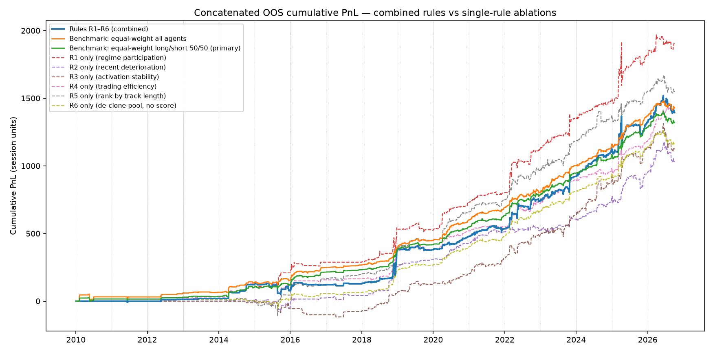

# Sauma Capital — Selecting Trading Agents from PnL Paths

🚧 **In progress.** This is a Deep Learning course project using data from Sauma Capital. Phase 1 (EDA) and Phase 2 (rule-based selection baseline) are done. Phase 3 (learned selection models) is next.

## Problem

Sauma runs a pool of **70 systematic agents** (45 long, 25 short) on a single equity-index futures product. Each agent is observed only as a 5-minute cumulative-PnL path from 2006 to 2026, about 1.5M rows per agent. The question is a **multi-manager selection** problem, not price forecasting:

> Using only information available at each decision date, can we pick a subset of agents that beats simply holding all of them?

## What's done

**Phase 1 — EDA on raw PnL paths** (`eda_*.py`, outputs in `outputs_eda_*`)
- Found that all non-zero PnL falls in one 120-minute session window, then rebuilt every statistic (moments, Sharpe, drawdown) on session-only bars so idle hours don't distort them.
- Identified the underlying by matching end-of-day prices against ES and NQ futures (`eda_underlying_fingerprint.py`).
- Measured trade frequency, holding spells, and agent co-activity. Compared PnL within each holding spell to a passive same-direction hold, to separate timing skill from market exposure.
- Checked **performance persistence**: the rank correlation of year-over-year agent Sharpe is about −0.04. Past winners are not future winners. This finding shaped everything after it.

**Phase 2 — Rule-based selection baseline** (`agent_selection_*.py`, write-up in [`docs/`](docs/agent_selection_rules_en.md))
- Six interpretable rules (R1–R6): side-aware regime participation, recent deterioration, efficiency/Calmar, and others. All thresholds were fixed in advance, not fitted.
- **Walk-forward, re-selected yearly** (2010–2026, 17 segments, using only prior data), stitched into one out-of-sample path.
- Benchmarked against the side-matched equal-weight pool **and a same-size random-selection null (300 draws)**.

| Portfolio (2010–2026, stitched OOS) | Sharpe | Max DD (PnL units) |
|---|---:|---:|
| Side-matched equal weight (benchmark) | **1.61** | 92 |
| Rules v0 (R1–R6) | 0.80 | 215 |
| Random pick, same size (median of 300) | 1.12 | – |
| Fix A: R1 with rolling stress threshold | 1.03 | 108 |
| Fix B: equal weight minus worst-20% by R2 | 1.60 | 95 |



**Result: negative, and informative.** The rules do worse than random selection, at the 5th–8th percentile of the null. The diagnostics explain why:
1. R1's stress threshold was anchored by 2008, so it never fired in 2012–2017. A rolling window fixes that, but the rule still has no selection power.
2. Agents trade only about 10 times a year, so participation-based features barely vary across agents.
3. Past-performance features carry no signal, consistent with the near-zero persistence above.
4. Holding about 12 agents instead of about 60 costs roughly 0.5 Sharpe in diversification alone, even with random picks. A selector has to overcome that loss first.

This matches DeMiguel, Garlappi & Uppal (2009): 1/N is hard to beat.

## Next (Phase 3)

The survey in [`docs/agent_selection_dl_survey.md`](docs/agent_selection_dl_survey.md) maps manager-selection and financial deep-learning literature onto this setup: sequence embeddings, end-to-end position networks, cross-sectional DNNs, and Sharpe-loss training. Planned work:
- [ ] Lightweight sequence embeddings (small LSTM / TCN on daily agent PnL) to compress each agent's path shape, activity pattern and volatility structure into a vector.
- [ ] Compare embedding-based similarity and clustering against the hand-built feature table and plain correlation clusters.
- [ ] Only then try supervised ranking, trained walk-forward with a carefully defined label. Evaluate against the same equal-weight and random-null benchmarks, including the true hold-out after 2026-10.

## Honest caveats

- The rules were designed after looking at the full history, so Phase 2 is **pseudo**-OOS.
- PnL is in raw dollar units; contract multiplier and costs are unconfirmed.
- The pool is thin before 2018 (0 long and 1–3 short agents live), so comparisons there carry little weight.

## Layout

```
eda_*.py                      Phase 1 EDA scripts
agent_selection_rules.py      R1–R6 + yearly walk-forward
agent_selection_diagnostics.py   single-rule ablation + random null
agent_selection_experiments.py   correction directions A / B
outputs_eda_*/                figures + summary tables (one folder per data cut)
outputs_rules_light/          Phase 2 results
docs/                         methodology, rule definitions, survey (EN + 中文)
```

Raw agent data is not included. Point the scripts at a local `Mini_*` / `Nasdaq_*` folder to rerun.
